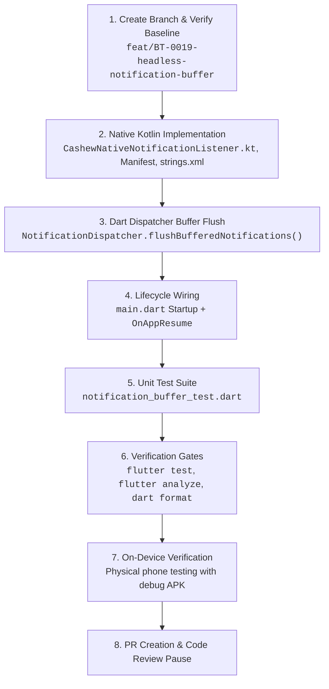

# Execution Plan: Headless Background Notification Capture via Native Buffer (BT-0019)

> **Task ID:** BT-0019  
> **Status:** Ready for Implementation  
> **Target Branch:** `feat/BT-0019-headless-notification-buffer`  
> **Target PR Base:** `main`  
> **Source Issue:** [#50](https://github.com/kidomarcostelo/budget-tracking/issues/50)  
> **Parent Research:** [research.md](research.md) | **Architecture Plan:** [plan.md](plan.md)

---

## 1. File Touch List

| Action | Path | Description |
|---|---|---|
| **Create** | `budget/android/app/src/main/kotlin/com/example/budget/CashewNativeNotificationListener.kt` | Native Kotlin `NotificationListenerService` subclass that intercepts payment notifications when the app is killed and writes them to `SharedPreferences`. |
| **Modify** | `budget/android/app/src/main/AndroidManifest.xml` | Register `CashewNativeNotificationListener` with `android.permission.BIND_NOTIFICATION_LISTENER_SERVICE`. |
| **Modify** | `budget/android/app/src/main/res/values/strings.xml` | Add localized strings for the pending transaction review notification channel and banner. |
| **Modify** | `budget/lib/struct/notificationDispatcher.dart` | Add `flushBufferedNotifications()` method to read, parse, dispatch, and clear buffered notifications. |
| **Modify** | `budget/lib/main.dart` | Invoke `flushBufferedNotifications()` at cold launch in `main()` and upon foreground resume in `OnAppResume`. |
| **Modify** | `budget/lib/struct/googlePayParser.dart` | Add debug simulation package check support so test notifications can be captured via ADB on physical hardware. |
| **Create** | `budget/test/notification_buffer_test.dart` | Comprehensive unit tests for buffer deserialization, malformed JSON recovery, deduplication, and event dispatch. |

---

## 2. Detailed Technical Specifications by File

### 2.1. `budget/android/app/src/main/kotlin/com/example/budget/CashewNativeNotificationListener.kt` (New File)

#### Responsibilities:
- System-bound `NotificationListenerService` that lives and wakes independently of the Flutter Engine.
- Filters incoming notifications for Google Wallet / Google Pay and recognized bank transaction patterns.
- Writes captured notification payloads directly to `FlutterSharedPreferences.xml` under key `flutter.cashew_notification_buffer`.
- Posts a low-priority Android notification prompting the user to open Cashew and review the pending transaction.

#### Implementation Outline:
```kotlin
package com.budget.tracker_app

import android.app.Notification
import android.app.NotificationChannel
import android.app.NotificationManager
import android.app.PendingIntent
import android.content.Context
import android.content.Intent
import android.os.Build
import android.service.notification.NotificationListenerService
import android.service.notification.StatusBarNotification
import androidx.core.app.NotificationCompat
import org.json.JSONArray
import org.json.JSONObject

class CashewNativeNotificationListener : NotificationListenerService() {

    companion object {
        const val PREFS_NAME = "FlutterSharedPreferences"
        const val BUFFER_KEY = "flutter.cashew_notification_buffer"
        const val CHANNEL_ID = "cashew_pending_notifications"
        const val NOTIFICATION_ID = 9992
        const val MAX_BUFFER_SIZE = 50

        val RECOGNIZED_PACKAGES = setOf(
            "com.google.android.apps.walletnfcrel",
            "com.google.android.apps.nbu.paisa.user",
            "com.google.android.gms"
        )
    }

    override fun onNotificationPosted(sbn: StatusBarNotification?) {
        super.onNotificationPosted(sbn)
        if (sbn == null) return

        val packageName = sbn.packageName ?: return
        val extras = sbn.notification?.extras ?: return

        val title = extras.getCharSequence(Notification.EXTRA_TITLE)?.toString() ?: ""
        val content = extras.getCharSequence(Notification.EXTRA_BIG_TEXT)?.toString()
            ?: extras.getCharSequence(Notification.EXTRA_TEXT)?.toString() ?: ""

        if (!isRelevantPaymentNotification(packageName, title, content)) {
            return
        }

        bufferNotification(
            id = sbn.id,
            packageName = packageName,
            title = title,
            content = content,
            timestamp = sbn.postTime
        )

        postReviewNotification(title, content)
    }

    private fun isRelevantPaymentNotification(packageName: String, title: String, content: String): Boolean {
        if (RECOGNIZED_PACKAGES.contains(packageName)) {
            return true
        }
        // Allow debug package simulation when testing via ADB
        if (BuildConfig.DEBUG && (packageName == "android" || packageName == applicationContext.packageName)) {
            if (title.contains("Google Pay", ignoreCase = true) || 
                title.contains("Google Wallet", ignoreCase = true) ||
                content.contains("Paid", ignoreCase = true) ||
                content.contains("Payment", ignoreCase = true)) {
                return true
            }
        }
        return false
    }

    @Synchronized
    private fun bufferNotification(id: Int, packageName: String, title: String, content: String, timestamp: Long) {
        try {
            val prefs = applicationContext.getSharedPreferences(PREFS_NAME, Context.MODE_PRIVATE)
            val currentRaw = prefs.getString(BUFFER_KEY, "[]") ?: "[]"
            val array = try { JSONArray(currentRaw) } catch (e: Exception) { JSONArray() }

            val item = JSONObject().apply {
                put("id", id)
                put("packageName", packageName)
                put("title", title)
                put("content", content)
                put("timestamp", timestamp)
            }

            array.put(item)

            // Cap buffer size to avoid unbounded growth
            val trimmedArray = if (array.length() > MAX_BUFFER_SIZE) {
                val newArray = JSONArray()
                for (i in (array.length() - MAX_BUFFER_SIZE) until array.length()) {
                    newArray.put(array.getJSONObject(i))
                }
                newArray
            } else {
                array
            }

            prefs.edit().putString(BUFFER_KEY, trimmedArray.toString()).apply()
        } catch (e: Exception) {
            e.printStackTrace()
        }
    }

    private fun postReviewNotification(title: String, content: String) {
        val manager = getSystemService(Context.NOTIFICATION_SERVICE) as? NotificationManager ?: return
        createNotificationChannel(manager)

        val launchIntent = packageManager.getLaunchIntentForPackage(packageName)?.apply {
            flags = Intent.FLAG_ACTIVITY_NEW_TASK or Intent.FLAG_ACTIVITY_CLEAR_TOP
        }

        val pendingIntent = PendingIntent.getActivity(
            this,
            0,
            launchIntent,
            if (Build.VERSION.SDK_INT >= Build.VERSION_CODES.M) {
                PendingIntent.FLAG_IMMUTABLE or PendingIntent.FLAG_UPDATE_CURRENT
            } else {
                PendingIntent.FLAG_UPDATE_CURRENT
            }
        )

        val notifTitle = getString(R.string.pending_transaction_notification_title)
        val notifText = getString(R.string.pending_transaction_notification_text)

        val notification = NotificationCompat.Builder(this, CHANNEL_ID)
            .setContentTitle(notifTitle)
            .setContentText(notifText)
            .setSmallIcon(R.drawable.notification_icon_android2)
            .setAutoCancel(true)
            .setContentIntent(pendingIntent)
            .setPriority(NotificationCompat.PRIORITY_DEFAULT)
            .build()

        manager.notify(NOTIFICATION_ID, notification)
    }

    private fun createNotificationChannel(manager: NotificationManager) {
        if (Build.VERSION.SDK_INT >= Build.VERSION_CODES.O) {
            val name = getString(R.string.pending_notification_channel_name)
            val desc = getString(R.string.pending_notification_channel_description)
            val channel = NotificationChannel(CHANNEL_ID, name, NotificationManager.IMPORTANCE_DEFAULT).apply {
                description = desc
                setShowBadge(true)
            }
            manager.createNotificationChannel(channel)
        }
    }
}
```

---

### 2.2. `budget/android/app/src/main/AndroidManifest.xml`

Add `CashewNativeNotificationListener` alongside the existing plugin listener:
```xml
        <!-- BT-0019: Native Kotlin Notification Buffer for killed-state capture -->
        <service
            android:name=".CashewNativeNotificationListener"
            android:label="Cashew Notification Capture"
            android:permission="android.permission.BIND_NOTIFICATION_LISTENER_SERVICE"
            android:exported="true">
            <intent-filter>
                <action android:name="android.service.notification.NotificationListenerService" />
            </intent-filter>
        </service>
```

---

### 2.3. `budget/android/app/src/main/res/values/strings.xml`

Add string resources for the pending notification channel and content:
```xml
    <!-- BT-0019: Pending Transaction Buffer Notifications -->
    <string name="pending_notification_channel_name">Pending Transactions</string>
    <string name="pending_notification_channel_description">Alerts for tap-to-pay transactions captured while Cashew was closed</string>
    <string name="pending_transaction_notification_title">Transaction Captured</string>
    <string name="pending_transaction_notification_text">Tap to review your recent payment in Cashew</string>
```

---

### 2.4. `budget/lib/struct/notificationDispatcher.dart`

Add buffer flushing methods to `NotificationDispatcher`:

```dart
  static const String bufferStorageKey = "cashew_notification_buffer";

  /// Flushes any pending notifications buffered in native SharedPreferences while
  /// Cashew was terminated or inactive.
  ///
  /// Returns the number of events successfully flushed and dispatched.
  Future<int> flushBufferedNotifications({
    SharedPreferences? preferencesOverride,
  }) async {
    final prefs = preferencesOverride ?? sharedPreferences;
    if (prefs == null) return 0;

    // Ensure the latest state from disk is reloaded
    await prefs.reload();
    final rawBuffer = prefs.getString(bufferStorageKey);
    if (rawBuffer == null || rawBuffer.trim().isEmpty || rawBuffer == "[]") {
      return 0;
    }

    // Immediately clear the buffer in SharedPreferences to prevent double-flushing
    await prefs.setString(bufferStorageKey, "[]");

    List<dynamic> entries;
    try {
      entries = jsonDecode(rawBuffer) as List<dynamic>;
    } catch (e) {
      print("NotificationDispatcher: Failed to decode notification buffer JSON: $e");
      return 0;
    }

    int processedCount = 0;
    for (final entry in entries) {
      if (entry is! Map<String, dynamic>) continue;
      try {
        final event = ServiceNotificationEvent(
          id: entry["id"] is int ? entry["id"] as int : 0,
          packageName: entry["packageName"] as String?,
          title: entry["title"] as String?,
          content: entry["content"] as String?,
          hasRemoved: false,
          canReply: false,
          haveExtraPicture: false,
          onGoing: false,
          timestamp: entry["timestamp"] is int ? entry["timestamp"] as int : 0,
          appIcon: null,
          extrasPicture: null,
          largeIcon: null,
        );

        final handled = await handleEvent(event);
        if (handled) processedCount++;
      } catch (e) {
        print("NotificationDispatcher: Error handling buffered event: $e");
      }
    }

    return processedCount;
  }
```

---

### 2.5. `budget/lib/main.dart`

Integrate buffer flush at both startup and resume:

1. **Cold Startup (`main()`):**
```dart
    if (getPlatform(ignoreEmulation: true) == PlatformOS.isAndroid) {
      await NotificationDispatcher.instance.flushBufferedNotifications();
      if (appStateSettings["notificationScanning"] == true) {
        await DedupeLedger.instance.loadFromDatabase();
        await BackgroundServiceManager.instance.startKeepAlive();
      }
    }
```

2. **Foreground Resume (`OnAppResume`):**
```dart
        Widget mainWidget = OnAppResume(
          updateGlobalAppLifecycleState: true,
          onAppResume: () async {
            await setHighRefreshRate();
            if (getPlatform(ignoreEmulation: true) == PlatformOS.isAndroid) {
              await NotificationDispatcher.instance.flushBufferedNotifications();
            }
          },
          ...
```

---

### 2.6. `budget/lib/struct/googlePayParser.dart`

Ensure test notifications sent during ADB simulation pass package recognition in debug mode:
```dart
  static bool isRecognizedPackage(String? packageName, {bool isDebug = kDebugMode}) {
    if (packageName == null) return false;
    if (recognizedPackages.contains(packageName)) return true;
    if (isDebug && (packageName == 'android' || packageName == 'com.budget.tracker_app.debug')) {
      return true;
    }
    return false;
  }
```

---

### 2.7. `budget/test/notification_buffer_test.dart` (New File)

Test cases:
1. `flushBufferedNotifications()` returns 0 and does not crash when buffer is empty or missing.
2. `flushBufferedNotifications()` recovers gracefully from malformed or corrupted JSON without throwing.
3. Successfully deserializes JSON entries into `ServiceNotificationEvent` and passes to `handleEvent`.
4. `DedupeLedger` prevents double-recording if an identical event was already handled in memory.
5. Clears `cashew_notification_buffer` in `SharedPreferences` to `[]` after reading.
6. Verifies that multiple buffered entries are processed sequentially.

---

## 3. Step-by-Step Implementation Sequence



---

## 4. Physical On-Device Testing & Verification Guide

This guide ensures the user can test and verify the fix on their physical Android device before merging the pull request.

### Step 1: Build & Sideload Isolated Debug APK
From `budget/`:
```powershell
flutter build apk --debug
```
Install the generated APK to the connected device:
```powershell
adb install -r build/app/outputs/flutter-apk/app-debug.apk
```
*(Package name: `com.budget.tracker_app.debug` due to BT-0010 build isolation).*

### Step 2: Grant Notification Access
On the physical device:
1. Go to **Settings** → **Apps** → **Special app access** → **Notification access**.
2. Find **Cashew (Debug)** (or **Cashew Notification Capture**).
3. Toggle permission **ON**.

### Step 3: Test Scenario A — App Killed (Force-Stop)
1. Launch Cashew (Debug) once, verify notification scanning is enabled in settings.
2. Force-kill the app process via ADB:
   ```powershell
   adb shell am force-stop com.budget.tracker_app.debug
   ```
3. Confirm the process is dead:
   ```powershell
   adb shell pidof com.budget.tracker_app.debug
   ```
   *(Must return nothing).*
4. Perform either:
   - **Option 1 (Real Transaction):** Make an actual tap-to-pay transaction with Google Wallet on the phone.
   - **Option 2 (Simulated Notification):**
     ```powershell
     adb shell cmd notification post -S bigtext -t "Google Pay" "Paid PHP 250.00 at Starbucks with MariBank"
     ```
5. **Observe:** The native status bar displays *"Transaction Captured: Tap to review your recent payment in Cashew"*.
6. Tap the notification (or launch Cashew from home screen).
7. **Verify:**
   - Cashew opens.
   - In-app notification / pending transaction appears at the top.
   - Amount `PHP 250.00`, merchant `Starbucks`, and card/wallet match.
   - Buffer in SharedPreferences has been cleared to `[]`.

### Step 4: Test Scenario B — App Swiped from Recent Apps
1. Open Cashew (Debug).
2. Swipe Cashew away from the Android Recent Apps / Multitasking screen.
3. Trigger a Google Wallet transaction.
4. Open Cashew → verify transaction appears in pending queue.

### Step 5: Test Scenario C — Device Reboot
1. Reboot phone via `adb reboot`.
2. Wait for system to restart.
3. Trigger Google Wallet transaction without launching Cashew first.
4. Launch Cashew → verify transaction is flushed and appears as pending.

---

## 5. Verification Checklist

Before opening the PR:
- [ ] `flutter analyze` passes with 0 errors and 0 warnings.
- [ ] `dart format --output=none --set-exit-if-changed .` passes with 0 diffs.
- [ ] `flutter test` passes 100% of tests.
- [ ] On-device manual test passed with app killed.
- [ ] Commit created with author `kidomarcostelo@gmail.com` and no co-author trailers.
- [ ] Feature branch pushed to fork, PR opened via `gh pr create`.
- [ ] Implementation agent pauses immediately for code review in dedicated session.
