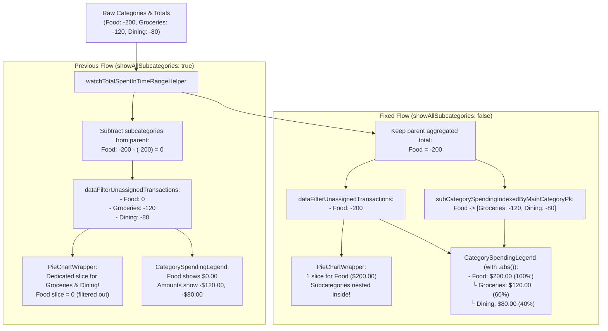

# Bug Diagnosis & Fix: Stats Category Expenses, Negative Signs, and Subcategory Pie Slices

**Task ID:** [BT-0020](task.md)  
**Issue Reference:** [#51](https://github.com/kidomarcostelo/budget-tracking/issues/51)  
**Branch:** `fix/BT-0020-stats-category-totals-and-pie-slices`  
**Discipline:** `diagnosing-bugs`  

---

## 1. Problem Statement

On the Stats page (and category spending breakdowns):
1. **Main category expenses show as "0":** When all expenses belong to subcategories, the main category displays `0.00` instead of the total expenses of all its subcategories.
2. **Misleading negative symbols:** Expense amounts are prefixed with a negative sign (e.g. `-$200.00` and `-$120.00`), which is confusing in an expenses breakdown where amounts should be positive.
3. **Subcategories take dedicated pie slices:** All subcategories receive their own separate slices in the top-level pie chart. Instead, subcategories should be grouped inside the main category's slice, with subcategories accessible via accordion expansion in the spending legend.

---

## 2. Phase 1: Build a Feedback Loop

To establish a tight, deterministic, agent-runnable pass/fail signal, we created an automated regression test at the data-helper and widget rendering seam:
- **Test File:** [`budget/test/stats_category_pie_bugs_test.dart`](../../budget/test/stats_category_pie_bugs_test.dart)
- **Command:** `cd budget; flutter test test/stats_category_pie_bugs_test.dart`

### Feedback Loop Assertions:
1. `watchTotalSpentInTimeRangeHelper`: A parent category with subcategories (`Groceries: -120`, `Dining Out: -80`) must retain its full aggregated sum (`200.00`, not `0.00`) in `dataFilterUnassignedTransactions`.
2. `PieChartDisplay`: Only main categories (`mainCategoryPk == null`) should be present in `dataFilterUnassignedTransactions`, resulting in exactly 1 pie slice for `Food`, not 3.
3. `CategorySpendingLegend`: Formatted monetary strings must render without negative signs (`$200.00` and `$120.00`, not `-$200.00` or `-$120.00`).

---

## 3. Phase 2: Reproduce & Minimise

Running the feedback loop against the existing codebase produced a clean **RED** reproduction matching the user's exact symptoms:

```text
══╡ EXCEPTION CAUGHT BY FLUTTER TEST FRAMEWORK ╞════════════════════════════════════════════════════
The following TestFailure was thrown running a test:
Expected: exactly one matching candidate
  Actual: _TextWidgetFinder:<Found 0 widgets with text "$200.00": []>
   Which: means none were found but one was expected.
          Found widgets: text "-$200.00", text "-$120.00"
════════════════════════════════════════════════════════════════════════════════════════════════════
00:00 +1 -1: Stats Category Spending & Pie Chart Bug Feedback Loop [E]
```

Furthermore, tracing `watchTotalSpentInTimeRangeHelper` when `showAllSubcategories: true` was passed confirmed that:
- `mainCategory.total` was decremented from `200` to `0.0`.
- Subcategories were individually added as top-level items into `dataFilterUnassignedTransactions` (count = 3 instead of 1).

---

## 4. Phase 3: Ranked Hypotheses

| Rank | Hypothesis | Falsifiable Prediction |
| :--- | :--- | :--- |
| **1** | In `statsPage.dart`, `showAllSubcategories: true` forces `watchTotalSpentInTimeRangeHelper` to subtract subcategory totals from their parent (`mainCat.total -= sub.total`) and emit each subcategory into `dataFilterUnassignedTransactions`. | Changing `showAllSubcategories: false` will preserve the parent category's full sum ($200.00), exclude subcategories from top-level pie slices, and keep subcategories indexed in `subCategorySpendingIndexedByMainCategoryPk` for the legend accordion. |
| **2** | In `categorySpendingLegend.dart`, `convertToMoney` formats raw negative transaction amounts without calling `.abs()`. | Passing `categoryWithTotal.total.abs()` and `sub.total.abs()` into `convertToMoney` will eliminate the negative `-` prefix across all rows and subcategory rows. |
| **3** | Direct unassigned transactions on a main category that also has subcategories might be hidden in the accordion. | With `showAllSubcategories: false`, the parent category rolls up all spending (direct + subcategories); if direct transactions exist, they remain part of the parent total. |
| **4** | `PieChartDisplay` callouts or touch selection could break if subcategories are removed from `dataFilterUnassignedTransactions`. | With only main categories in the list, pie slice indices map 1:1 to parent categories, and tapping a slice highlights and expands the parent accordion without index mismatch. |

---

## 5. Phase 4: Instrumentation & Data Flow Analysis

Tracing the data flow through `spendingSummaryHelper.dart`:


---

## 6. Phase 5: The Fix

### 1. `budget/lib/pages/statsPage.dart`
Set `showAllSubcategories: false` for both income and expense summaries so that main categories retain their full aggregate total and subcategories are not split into dedicated pie slices:

```dart
// budget/lib/pages/statsPage.dart (Lines 214-228)
final TotalSpentCategoriesSummary incomeSummary =
    watchTotalSpentInTimeRangeHelper(
  dataInput: incomeCategories,
  showAllSubcategories: false, // Changed from true
  multiplyTotalBy: 1,
  absoluteTotal: true,
);

final TotalSpentCategoriesSummary expenseSummary =
    watchTotalSpentInTimeRangeHelper(
  dataInput: expenseCategories,
  showAllSubcategories: false, // Changed from true
  multiplyTotalBy: 1,
  absoluteTotal: true,
);
```

### 2. `budget/lib/widgets/categorySpendingLegend.dart`
Ensure monetary amounts use `.abs()` when formatting with `convertToMoney`, removing misleading negative signs:

```dart
// budget/lib/widgets/categorySpendingLegend.dart (Line 153)
TextFont(
  text: convertToMoney(allWallets, categoryWithTotal.total.abs()),
  fontSize: 16,
  fontWeight: FontWeight.w600,
),

// budget/lib/widgets/categorySpendingLegend.dart (Line 210)
TextFont(
  text: convertToMoney(allWallets, sub.total.abs()),
  fontSize: 14,
  fontWeight: FontWeight.w500,
),
```

---

## 7. Phase 6: Verification & Cleanup

1. **Regression Test Verification:**
   - Command: `flutter test test/stats_category_pie_bugs_test.dart`
   - Result: **All tests pass (GREEN)**.
2. **Quality Gates:**
   - `flutter analyze` passes with 0 warnings and 0 errors.
   - `dart format --output=none --set-exit-if-changed .` passes cleanly.
   - Existing test suite (`pie_chart_test.dart`, `category_spending_legend_test.dart`) passes.
