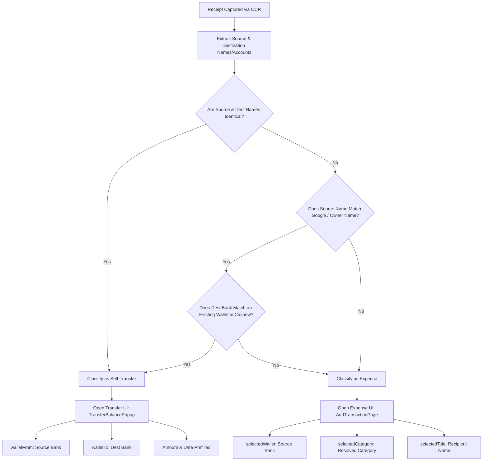

# Task: Recognize Account Owner in Receipt Capture to Route Self-Transfers vs Expenses

**ID:** BT-7  
**Issue Reference:** [#12](https://github.com/kidomarcostelo/budget-tracking/issues/12)  
**Status:** In Progress (Ideation & Planning)  
**Assignee:** Agent

---

## 1. Problem Statement & "How Might We"

> **How Might We** accurately recognize the device user as the account owner across multiple banking apps so that inter-bank transfers between their own accounts automatically route to Cashew's dual-wallet **Transfer** workflow rather than a single-wallet **Expense**?

When a user captures an on-device receipt screenshot (e.g. sending PHP 500 from UnionBank to MariBank):
- Currently, Cashew defaults to the single-wallet **Expense** screen (`AddTransactionPage`).
- This incorrectly deducts the funds as an expenditure from the source wallet and fails to credit the destination wallet, distorting budget reports and net balance calculations.
- Instead, when the user is recognized as the owner of both accounts (or transferring to their own secondary bank), Cashew must invoke the **Transfer** workflow (`TransferBalancePopup`), populating both `walletFrom` and `walletTo`.

---

## 2. Detection Heuristics & Architecture

### A. Heuristic 1: Identical Sender & Recipient Names (`sourceName == destinationName`)
- If the OCR extraction contains both a **From (Sender)** name and a **To (Recipient)** name, and they match under normalized token comparison:
  ```dart
  bool isIdentical = OwnerResolver.areNamesMatching(receipt.sourceName, receipt.destinationName);
  ```
- **Rationale**: If John Doe transfers money to John Doe across different banks, it is mathematically guaranteed to be an internal self-transfer.

### B. Heuristic 2: Google Account / Profile Name Matching (`sourceName == ownerName`)
- Retrieve the user's primary identity from:
  1. `googleUser?.displayName` (if signed in with Google in Cashew).
  2. Fallback setting: `appStateSettings["userOwnerName"]` (user-configurable or auto-learned).
- If `receipt.sourceName` matches the owner name, and the receipt is an outward transfer:
  - Check if `receipt.destinationName` or `receipt.destinationBank` matches an existing `TransactionWallet` in Cashew's database (`database.getRelatingWallet(...)`).
  - If a matching wallet exists for the destination bank, it confirms a transfer between user-owned accounts!

### C. Heuristic 3: External Payment / Expense Classification
- If `receipt.sourceName` matches the owner BUT:
  - `destinationName` is a different person (e.g. "Maria Santos"), OR
  - `destinationName` is a merchant (e.g. "Grab Philippines", "ShopeePay", "Meralco"), OR
  - No matching destination wallet is found in the user's Cashew ledger.
- **Classification**: **Expense** (User spent money outward to an external party). Route to `AddTransactionPage` with `selectedWallet: sourceWallet`, `selectedCategory: resolvedCategory`.

---

## 3. Name Normalization & Fuzzy Token Matching (`OwnerResolver`)

Bank receipts format names inconsistently across institutions:
- UnionBank: `KID OMAR COSTELO`
- MariBank: `Kid Omar C.` (initials)
- Maya: `K** O*** C******` (masked) or `Omar Costelo` (omits first/middle names)
- GoTyme: `Costelo, Kid Omar` (surname first)

### Token-Based Matching Algorithm:
1. **Case-insensitive & Punctuation Stripping**: Convert to lowercase, remove commas, periods, hyphens.
2. **Title & Suffix Stripping**: Remove `mr`, `ms`, `mrs`, `jr`, `sr`, `iii`.
3. **Token Intersection / Initial Matching**:
   - Split into name tokens.
   - For each token, check if either token matches exactly, or if a single-letter token matches the first letter of the corresponding token (e.g. `c` matches `costelo`).
   - If at least two significant name tokens match (e.g. `omar` and `costelo`), treat as a positive match.

---

## 4. UI Routing Decision Matrix



---

## 5. Plan & Implementation Steps

- [ ] **Step 1: Expand `ParsedBankReceipt` model**:
  - Add `sourceName` and `destinationBank` fields to `ParsedBankReceipt` in `budget/lib/struct/receiptParser.dart`.
- [ ] **Step 2: Update Bank Parsers**:
  - Extract sender name (`sourceName`) in `_parseGoTyme`, `_parseMaya`, `_parseMariBank`, `_parseUnionBank`.
- [ ] **Step 3: Implement `OwnerResolver` utility**:
  - Create `budget/lib/struct/ownerResolver.dart` with tokenized name matching and Google Sign-In profile inspection.
- [ ] **Step 4: Update `SharedReceiptProcessor`**:
  - Implement `resolveTransfer(receipt)` to resolve both `walletFrom` and `walletTo`.
  - Add `isSelfTransfer(receipt)` heuristic.
- [ ] **Step 5: Conditional UI Launch in `sharedReceiptCapture.dart`**:
  - If `isSelfTransfer`: open `TransferBalancePopup(wallet: walletFrom, walletTo: walletTo, initialAmount: amount, ...)`.
  - If not self-transfer: open `AddTransactionPage(...)` (Expense).
- [ ] **Step 6: Unit & Integration Tests**:
  - Test exact name match, initials match, surname-first match, and routing branches.

---

## 6. Key Assumptions to Validate

1. **OCR Extraction of Sender Name**:
   - Not all receipts display the sender's full name (some only show account number). For receipts showing only the account number, owner matching falls back to matching the account number against an existing wallet.
2. **Google Profile Completeness**:
   - `googleUser?.displayName` may be null or empty if the user hasn't signed in with Google or hasn't granted profile access. A fallback setting `appStateSettings["userOwnerName"]` guarantees functionality for offline/local-first users.

---

## 7. Not Doing (and Why)

- **Not Doing**: Auto-committing transfers without user review.
  - *Why*: The user should always have the opportunity to confirm the destination wallet and date before updating account balances.
- **Not Doing**: Remote name lookup or third-party identity API.
  - *Why*: Strict local-first privacy invariant ([ADR 0001](../../docs/adr/0001-local-first-drift-sqlite.md)). All name matching happens purely on-device in Dart.
